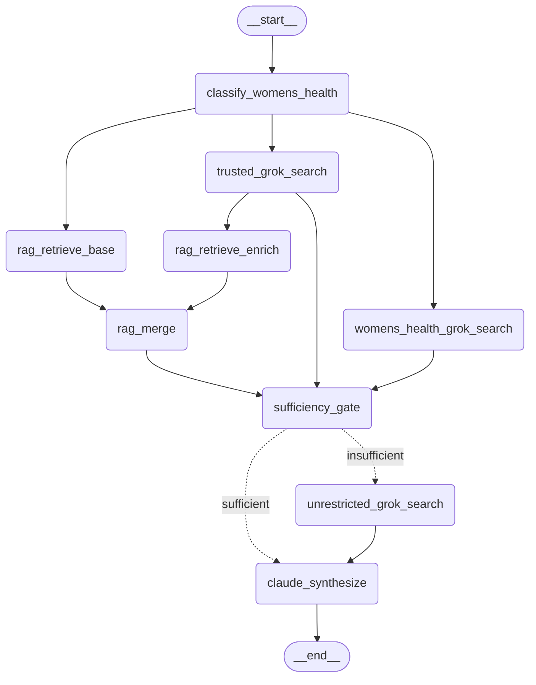

# Root Cause — backend

A LangGraph health agent that answers wellness questions using four kinds of evidence, ranked by trust:

1. a curated research archive (296 Markdown resources, searched with hybrid RAG)
2. trusted X accounts
3. trusted women's-health X accounts (only for women's-health questions)
4. unrestricted X search (only when the first three are not enough)

Claude writes the final answer. Grok searches X. Voyage AI handles embeddings and reranking. Postgres with pgvector stores the chunks and the conversation checkpoints. The chat UI lives in [root-cause-frontend](https://github.com/Mumbo-Jumbo-3/root-cause-frontend).

<!-- TODO: 30-second demo GIF: ask a question, watch the phases stream, read the answer -->

## How a question flows



The diagram comes from the compiled graph (only the edge labels were added by hand). Regenerate it after changing [`graph.py`](src/health_agent/graph.py):

```bash
ANTHROPIC_API_KEY=x XAI_API_KEY=x uv run python -c "from health_agent.config import Settings; from health_agent.graph import build_graph; print(build_graph(Settings()).get_graph().draw_mermaid())"
```

- **Fan-out.** A Haiku classifier flags women's-health questions. Base RAG, trusted X search and women's-health X search then run in parallel. The women's-health search is skipped for other questions.
- **Enrichment.** Besides its findings, trusted X search returns rewritten queries. Those queries run a second RAG pass, which pulls in archive material the user's wording would have missed.
- **Merge.** The base and enriched results are combined with reciprocal rank fusion, then reranked against the original question.
- **Gate.** A Claude judge reads the evidence and decides whether it is enough. If not, unrestricted X search runs before synthesis.
- **Synthesis.** Claude Sonnet writes one integrated answer, ranking evidence by source and noting any channel that came back empty or failed.

Each node reports `started` / `completed` phase events, so the UI can show progress while the answer is being prepared.

## Design decisions

**Why a judge.** Unrestricted X search is the slowest and least trustworthy source, so it should only run when needed. A fixed rule such as "fewer than N chunks" can't tell five on-topic chunks from five tangential ones. A single LLM call over the actual evidence can, and it's cheaper than always running the extra search. The gate fails safe: if an upstream branch errors, or the judge errors or returns bad JSON, it treats the evidence as insufficient. Failures add evidence rather than silently dropping it.

**Why fused ranking plus reranking.** These are two separate jobs. Ranking fuses results in two places. Within each query, vector search (60% weight) and Postgres full-text search (40%) are combined with reciprocal rank fusion. Vector search catches paraphrases; full-text search catches exact terms like nutrient names, dosages and compounds, which embeddings often blur together. Across queries, the base and enriched result lists are fused again. Fusion is cheap and casts a wide net (up to 80 candidates), but it scores by rank position, not relevance. A Voyage `rerank-2.5` cross-encoder then scores each candidate against the original question, keeps the top 12, and drops anything below 0.3. Fusion makes sure nothing is missed; the reranker decides what Claude actually reads.

**Why the evidence ranking.** The sources aren't equally reliable, and the answer should reflect that rather than averaging them together. The curated archive was hand-picked and is the most stable. Trusted accounts are vetted but newer and less formal. Unrestricted X is a broad, noisy fallback. The synthesis prompt gets these as a numbered list, tells Claude to resolve conflicts in favor of the higher-ranked source and say so, and only lists channels that were actually consulted. Claude never reasons about a source it didn't receive.

## Evaluation

[`rag/evaluation.py`](src/health_agent/rag/evaluation.py) scores retrieval against 8 hand-written questions, each with the archive sources that should come back. It compares the two retrieval strategies: `legacy` (top-k vector search plus keyword search; the production default) and `hybrid_v2` (a deeper vector candidate pool plus keyword search). Modes:

- `retrieval`: only the base retrieval for the original question, up to 80 chunks
- `production-context`: the full production path (base plus enriched queries, RRF, rerank), at most 12 chunks
- `production-packed`: the same path, capped at 3 chunks per source

| Mode | Strategy | Hits | MRR | Source MRR | Source coverage | Mean latency |
| ---- | -------- | ---: | --: | ---------: | --------------: | -----------: |
| `retrieval` | `legacy` | 8/8 | 0.84 | 0.84 | 0.73 | 1.9 s |
| `retrieval` | `hybrid_v2` | 8/8 | 0.83 | 0.88 | 0.92 | 0.9 s |
| `production-context` | `legacy` | 8/8 | 0.64 | 0.66 | 0.71 | 5.5 s |
| `production-context` | `hybrid_v2` | 8/8 | 0.64 | 0.66 | 0.65 | 3.5 s |
| `production-packed` | `legacy` | 8/8 | 0.70 | 0.72 | 0.77 | 5.5 s |
| `production-packed` | `hybrid_v2` | 8/8 | 0.70 | 0.72 | 0.65 | 3.6 s |

*Hits:* an expected source appears anywhere in the context. *MRR:* reciprocal rank of the first chunk from an expected source. *Source MRR:* the same, counting each source once. *Coverage:* the share of expected sources that appear. Run on 2026-10-23 against the production index. Latency includes Voyage API calls and network round trips to the database.

What the numbers say:

- **Reranking shrinks the context without losing sources.** It cuts up to 80 candidates to at most 12, and with `legacy` coverage barely moves (0.73 → 0.71).
- **It also demotes the best match.** MRR drops from 0.84 to 0.64: in 3 of 8 questions, the expected source that base retrieval ranked first lands at rank 2–4. Eight questions with source-level labels can't tell whether that's the reranker's fault or the labels are too narrow, which is what the oracle eval below is for.
- **Capping chunks per source helps a little** (MRR 0.64 → 0.70). Production doesn't use it yet; it only exists in the eval.
- **`hybrid_v2` wins on raw retrieval** (coverage 0.92 vs 0.73, at half the latency), **but not after reranking** (0.65 vs 0.71), so there's no case yet for switching the default away from `legacy`.

```bash
uv run health-agent eval-rag --strategy both --mode production-context
```

[`rag/oracle_eval.py`](src/health_agent/rag/oracle_eval.py) adds a claim-level check. An LLM labels which chunks support each claim a good answer needs; after review, `--mode oracle-context` scores claim coverage and context noise. The oracle file ([`evals/rag_context_oracle.json`](evals/rag_context_oracle.json)) is generated by `health-agent build-rag-oracle`; its claims have not been reviewed yet.

## Running locally

Requires Python 3.11+, [uv](https://docs.astral.sh/uv/), and Postgres with the `pgvector` extension.

```bash
uv sync
cp .env.example .env   # fill in API keys and DATABASE_URL
set -a; source .env; set +a   # settings come from the environment, not from .env directly
uv run alembic upgrade head
uv run health-agent ingest              # embeds the resources/ files that changed
uv run uvicorn health_agent.server:app --port 2024
```

`uv run health-agent chat` starts a terminal chat that needs no frontend. Settings are read from environment variables; [`config.py`](src/health_agent/config.py) lists every setting and its default.

```bash
uv run pytest
```

## Deploying

Production runs on [Render](https://render.com) with Postgres on [Neon](https://neon.com). [`render.yaml`](render.yaml) is a Blueprint for one Docker web service built from the [`Dockerfile`](Dockerfile), in Render's Ohio region next to Neon's `us-east-2`. Every push to `main` deploys. Before the new instance takes traffic, Render runs `health-agent predeploy` (`alembic upgrade head`, then `health-agent ingest`) as the pre-deploy step, so a migration lands before the code that needs it and never runs twice at once, and the RAG index matches the deployed `resources/`. Render health-checks `/ok`. On a deploy, the old instance gets up to 120 seconds to finish in-flight chats before it is stopped.

Neon supplies two connection strings. `DATABASE_URL` is the pooled one (host contains `-pooler`) and is what the app uses. `DATABASE_URL_UNPOOLED` is the direct one, which Alembic and `pg_dump` need. Both are set on the Render service.

Secrets are marked `sync: false` in the Blueprint, so Render asks for them when the Blueprint is first applied and never reads them from the repo. Change them later in the service's Environment tab.

Ingest makes the index match `resources/` exactly: new and edited files are embedded, and files that aren't on disk are removed from the index. It embeds only what changed, so most deploys make no Voyage calls. A resource counts as changed when its text changes, or when anything that shapes its chunks changes: `EMBEDDING_MODEL`, `CHUNK_SIZE`, `CHUNK_OVERLAP`, or `INGEST_VERSION` in [`rag/resources.py`](src/health_agent/rag/resources.py). Bump `INGEST_VERSION` whenever you change how documents are chunked or titled, and the next deploy re-embeds everything (about 16k chunks in 126 Voyage requests).

All embedding happens before the write transaction opens, so a failed ingest fails the deploy and leaves the index as it was. Ingest refuses to run when `resources/` is missing or empty rather than empty the index, and it takes a Postgres advisory lock, so a manual run can't collide with a deploy. `resources/nutrients/` is generated: after editing a nutrient page, run `health-agent sync-nutrient-resources` and commit the result (a test fails until you do).

### Migration from Cloudflare

Moved on October 29, 2026. The Neon database stayed where it was; only the app moved. The Render service was created from the Blueprint, the frontend's `LANGGRAPH_API_URL` was switched to `https://root-cause-backend.onrender.com`, and once a chat had run cleanly the Cloudflare Worker, its container application and its images were deleted. The Worker code is in the history at `4802e16` if it is ever needed again.

### Migration from Railway

Moved on October 23, 2026. The Railway database was copied into the Neon project `root-cause` with [`scripts/copy_database.sh`](scripts/copy_database.sh), and every table's row count matched. It was then migrated to `20261023_01`, which drops the retired Catamine tables. Finally, the frontend's `LANGGRAPH_API_URL` was switched to the Cloudflare Worker that served production until the move to Render. Railway's `CATAMINE_*`, `CORS_ORIGINS` and `OPENAI_API_KEY` were not carried over, because nothing reads them.

To reuse the copy script, restore into an empty database before the container first boots. On startup the app creates the LangGraph checkpoint tables, and the restore would then fail on them.

## Layout

| Path | What's there |
| ---- | ------------ |
| [`src/health_agent/graph.py`](src/health_agent/graph.py) | The LangGraph: nodes, prompts, routing |
| [`src/health_agent/rag/`](src/health_agent/rag) | Ingest, hybrid retrieval, RRF, rerank, evals |
| [`src/health_agent/server.py`](src/health_agent/server.py) | FastAPI server: streaming runs, threads, sharing, Clerk auth |
| [`resources/`](resources) | The curated archive the RAG indexes |
| [`render.yaml`](render.yaml) | Render Blueprint for the production service |
| [`alembic/`](alembic) | Database migrations |
| [`evals/`](evals) | Eval fixtures |
